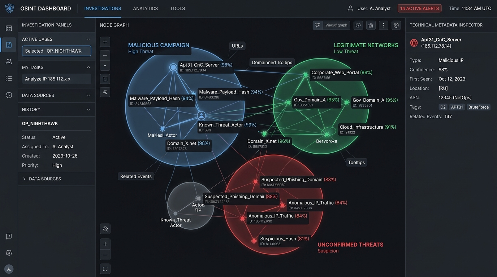
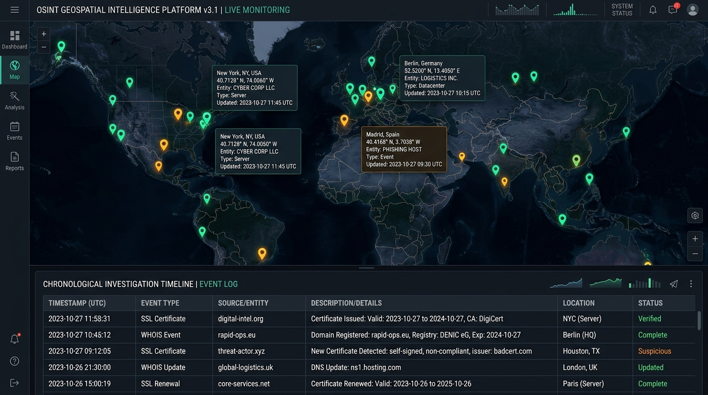
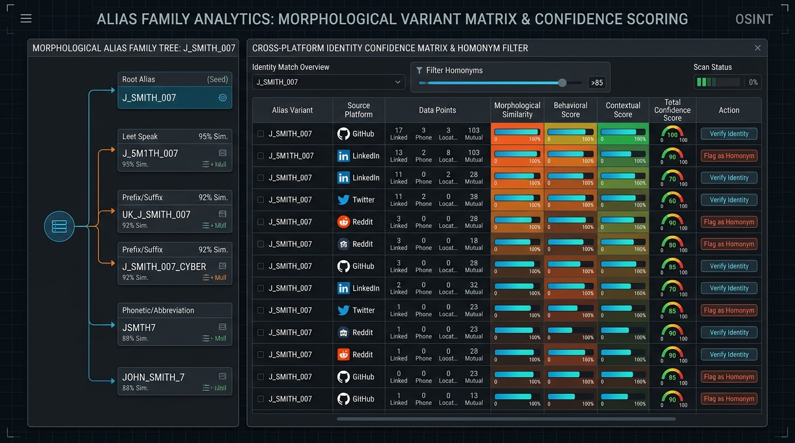
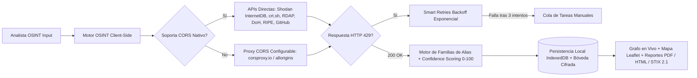

<div align="center">
  <a href="https://www.unfantasmaenelsistema.com/" target="_blank">
    
  </a>

  # Fantasma OSINT — Plataforma Visual de Investigación e Inteligencia Abierta

  **Plataforma integral de investigación OSINT y Ciberinteligencia (CTI) 100% Client-Side (Serverless), diseñada para ejecutarse directamente en el navegador y alojarse de forma nativa en GitHub Pages.**

  [**🌐 Web Oficial: Un Fantasma en el Sistema**](https://www.unfantasmaenelsistema.com/) · [**📄 Documentación de Arquitectura**](#-arquitectura-100-client-side-serverless) · [**🚀 Despliegue en GitHub Pages**](#-despliegue-en-github-pages)

</div>

---

## 📸 Capturas de Pantalla de la Plataforma

### 1. Grafo de Investigación en Vivo con Agrupación en Burbujas (`Live Graph`)
Visualización interactiva dirigida por fuerzas con agrupación dinámica en **burbujas por Tipo de Entidad, Plataforma o Familia de Alias**, halos de puntuación de confianza (`0–100`), inspector de metadatos técnicos y pivoteo de entidades en un clic.



### 2. Inteligencia Geoespacial (`Leaflet.js`) y Línea de Tiempo Cronológica
Extracción automática de coordenadas desde direcciones IP (`GeoIP / ASN`), jurisdicciones telefónicas (`UIT E.164`) y biografías de perfiles públicos, combinada con una línea de tiempo cronológica de creaciones de cuentas, certificados TLS (`crt.sh`), registros `RDAP/WHOIS` y capturas históricas de `Wayback Machine`.



### 3. Motor de Familias de Alias (`Leet Speak 1337`) y Matriz Anti-Homónimos (`Confidence Scoring`)
Generador heurístico de variantes morfológicas a partir de la raíz de un alias y matriz multicriterio de puntuación de confianza (`0–100`) para separar perfiles reales confirmados de falsos positivos (homónimos).



---

## ✨ Características Principales

- **7 Puntos de Entrada Unificados (`Inputs`)**: Inicia o pivota investigaciones a partir de un **Nombre de Usuario**, **Correo Electrónico**, **Dominio/URL**, **Dirección IP**, **Teléfono (E.164)**, **Nombre Real** o **Identificador Nacional (DNI/NIE con validación Módulo-23)**.
- **Grafo Interactivo con Burbujas Dinámicas**: Basado en HTML5 Canvas de alto rendimiento con física de resortes, agrupación visual en burbujas translúcidas, filtrado por umbral de confianza y exportación directa a imagen `PNG`, **STIX 2.1 (`.stix.json`)** y **Maltego / Gephi (`.csv`)**.
- **Algoritmo de Puntuación de Confianza (`0–100`)**: Pondera automáticamente coincidencias de identificador raíz (`+30`), similitud morfológica de alias (`+20`), nombre/biografía cruzada (`+20`), correlación geográfica (`+15`) y dominio/hash de avatar (`+15`).
- **Motor de Familias de Alias (`Alias Families`)**: Extrae la raíz morfológica del objetivo y genera variantes en *Leet Speak (`a->4, e->3, i->1, o->0, s->5`)*, duplicación de caracteres, separadores (`_`, `.`, `-`) y sufijos habituales (`_sec`, `_dev`, `real_`, `iam`).
- **Gestión Inteligente de Límites de Tasa (`HTTP 429 Smart Retries`)**: Cuando una red social devuelve `HTTP 429` o un desafío anti-bot, el motor ejecuta reintentos con pausa exponencial (*Exponential Backoff*) y, si persiste el bloqueo, deriva el objetivo a la cola interactiva de **Tareas Manuales**.
- **Laboratorio Forense Local y Cadena de Custodia (`SHA-256`)**:
  - Cálculo criptográfico `SHA-256` mediante **Web Crypto API** sobre cada expediente y evidencia recolectada.
  - **Inspector Forense de Archivos en Navegador**: Arrastra cualquier imagen o documento para calcular su hash `SHA-256` e inspeccionar cabeceras binarias y metadatos EXIF/XMP sin subir el archivo a ningún servidor.
- **Generación de Informes Periciales (`PDF`, `HTML Estático`, `STIX 2.1`, `CSV`)**: Exportación completa del caso con `jsPDF` y HTML5 autocontenido con sello de integridad `SHA-256`.
- **Integración Opcional con IA (`OpenAI API`) + Sintetizador Heurístico Local**: Genera resúmenes ejecutivos de inteligencia utilizando tu propia llave de OpenAI (`gpt-4o-mini` / `gpt-4o`) o mediante el motor heurístico determinista integrado (sin necesidad de API Key).

---

## 🔌 Fuentes y Herramientas OSINT Integradas

| Categoría | Fuente / Herramienta | Requiere API Key | Método Client-Side | Datos Extraídos |
| :--- | :--- | :---: | :--- | :--- |
| **Usuarios (Sherlock)** | **Catálogo 58 Sitios** (GitHub, GitLab, Reddit, Dev.to, HackerNews, Keybase, Lichess, Chess.com, Crates.io, Bluesky, Mastodon, etc.) | ❌ No | JSON Directo + Proxy CORS (`HTTP 200`) | Existencia de cuenta, fecha de alta, bio, ubicación, web, seguidores y repositorios |
| **Correos** | **XposedOrNot API** | ❌ No | Fetch Directo / Proxy | Brechas de datos públicas asociadas al correo |
| **Correos** | **Google DNS-over-HTTPS (DoH)** | ❌ No | `dns.google/resolve` | Servidores de correo `MX` y políticas `SPF` / `DMARC` |
| **Correos** | **Gravatar SHA-256 & OpenPGP** | ❌ No | WebCrypto + `keys.openpgp.org` | Huella criptográfica de avatar y búsqueda de llaves PGP |
| **Correos** | **Have I Been Pwned (HIBP) & Hunter.io** | 🔑 Opcional | Bóveda Local Cifrada | Detalle extendido de brechas y verificación SMTP corporativa |
| **Dominios** | **crt.sh (Certificate Transparency)** | ❌ No | `crt.sh/?q=%.dom&output=json` | Subdominios históricos y fechas de emisión de certificados TLS |
| **Dominios** | **RDAP / WHOIS Oficial** | ❌ No | `rdap.org/domain/{dom}` | Fecha de registro, expiración, registrador, DNSSEC y nameservers |
| **Dominios** | **Wayback Machine (Archive.org)** | ❌ No | `archive.org/wayback/available` | Capturas históricas archivadas y fechas de snapshot |
| **Dominios** | **VirusTotal v3 & URLScan.io** | 🔑 Opcional | Bóveda Local Cifrada | Reputación multidetección, ASN y capturas de pantalla web |
| **IPs y Redes** | **Shodan InternetDB** | ❌ No | `internetdb.shodan.io/{ip}` | Puertos abiertos pasivos, CPEs, hostnames, tags y vulnerabilidades CVE |
| **IPs y Redes** | **RIPE Stat BGP & GeoIP (`ipwho.is`)** | ❌ No | Fetch CORS Nativo | Prefijo CIDR BGP, titular del ASN, ISP y coordenadas para el mapa Leaflet |
| **Identidades** | **Validador DNI/NIE Mod-23 & E.164** | ❌ No | Algoritmo Local + Dorks | Verificación matemática de letra DNI/NIE, jurisdicción ITU y Google Dorks |
| **Búsqueda Web** | **Serper.dev Google Search API** | 🔑 Opcional | Bóveda Local Cifrada | Resultados de búsqueda web y Google Dorking en vivo |

---

## 🏗️ Arquitectura 100% Client-Side (Serverless)



### Estructura de Carpetas del Proyecto

```text
fantasma-osint/
├── .github/workflows/
│   └── deploy.yml                         # CI/CD automático para GitHub Pages
├── public/
│   ├── .nojekyll                          # Evita procesado Jekyll en GitHub Pages
│   └── assets/aistudio/
│       └── icono_81a3db5b.png             # Logotipo oficial Un Fantasma en el Sistema
├── src/
│   ├── assets/images/                     # Capturas de pantalla para documentación y vista previa
│   ├── components/
│   │   ├── InteractiveGraph.tsx           # Grafo interactivo con agrupación en burbujas
│   │   ├── AliasAndConfidenceView.tsx     # Motor de Familias de Alias y Matriz 0-100
│   │   ├── GeoTimelineView.tsx            # Mapa interactivo Leaflet.js y Línea de Tiempo
│   │   ├── ManualTasksAndRetryView.tsx    # Monitor HTTP 429 Smart Retries y Catálogo Sherlock
│   │   └── CredentialsAndArchView.tsx     # Bóveda cifrada API Keys, Forense SHA-256 y Kit GitHub
│   ├── data/
│   │   └── sherlockSites.json             # 58 plantillas de URL estilo Sherlock
│   ├── services/
│   │   ├── osintEngine.ts                 # Orquestador de peticiones fetch, reintentos y APIs
│   │   ├── aliasAndConfidenceEngine.ts    # Algoritmo morfológico 1337 y puntuación 0-100
│   │   ├── storageService.ts              # Persistencia IndexedDB y cifrado XOR+Base64
│   │   └── reportGenerator.ts             # Exportación PDF (jsPDF), HTML, STIX 2.1 y CSV Maltego
│   ├── types/
│   │   └── osint.ts                       # Contratos TypeScript de entidades y evidencias
│   ├── App.tsx                            # Consola principal de investigación
│   └── index.css                          # Sistema de diseño oscuro y estilos Leaflet
├── index.html                             # Entrada principal HTML5
├── vite.config.ts                         # Configuración estática con base: './'
├── package.json
└── README.md
```

---

## 🚀 Instalación Local y Despliegue en GitHub Pages

### 1. Ejecución en Entorno Local

```bash
# Clonar el repositorio
git clone https://github.com/tu-usuario/fantasma-osint.git
cd fantasma-osint

# Instalar dependencias
npm install

# Iniciar servidor de desarrollo (puerto 3000)
npm run dev
```

### 2. Despliegue Automático en GitHub Pages

El proyecto ya incluye el flujo de trabajo oficial en `.github/workflows/deploy.yml` y configuración de rutas relativas (`base: './'` en `vite.config.ts`):

1. Sube este repositorio a tu cuenta de GitHub (`git push origin main`).
2. En tu repositorio de GitHub, ve a **Settings → Pages**.
3. En **Build and deployment → Source**, selecciona **GitHub Actions**.
4. Cada `push` a la rama `main` compilará automáticamente la carpeta estática `dist/` y publicará la plataforma en `https://<tu-usuario>.github.io/<tu-repositorio>/`.

---

## ⚖️ Aviso Legal y Uso Ético

Esta plataforma ha sido diseñada con fines estrictamente educativos, de auditoría de huella digital propia, investigación defensiva y Ciberinteligencia de Fuentes Abiertas (OSINT). El analista es el único responsable de cumplir con las normativas vigentes de protección de datos y términos de servicio de las fuentes consultadas.

Desarrollado por **[Un Fantasma en el Sistema](https://www.unfantasmaenelsistema.com/)**. Licencia MIT.
