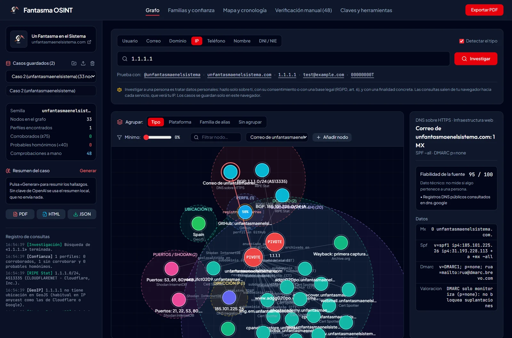
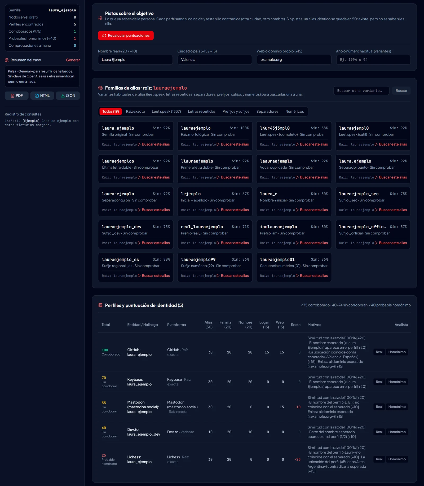
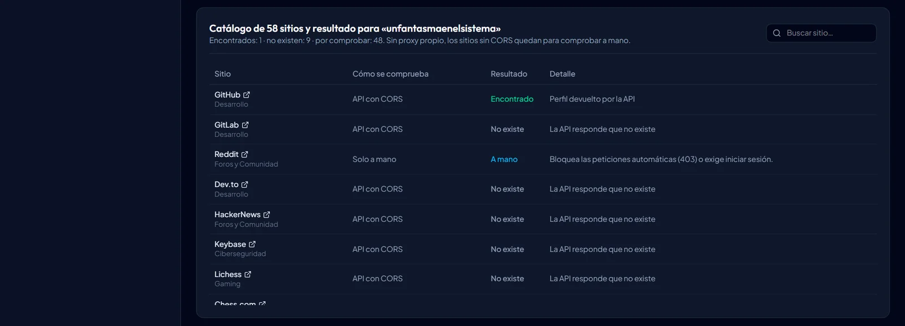
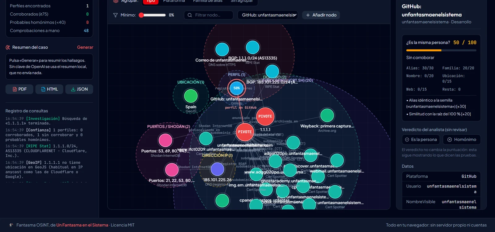
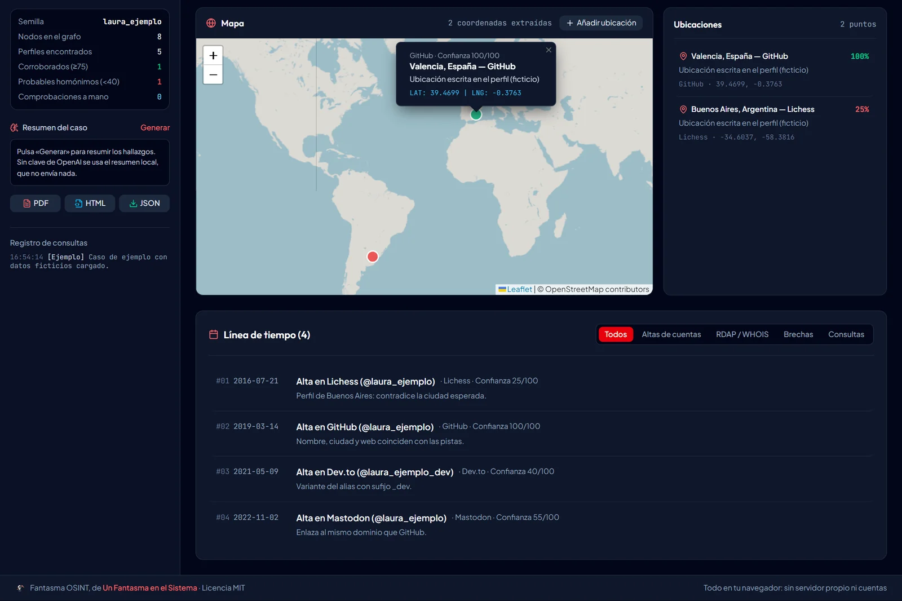
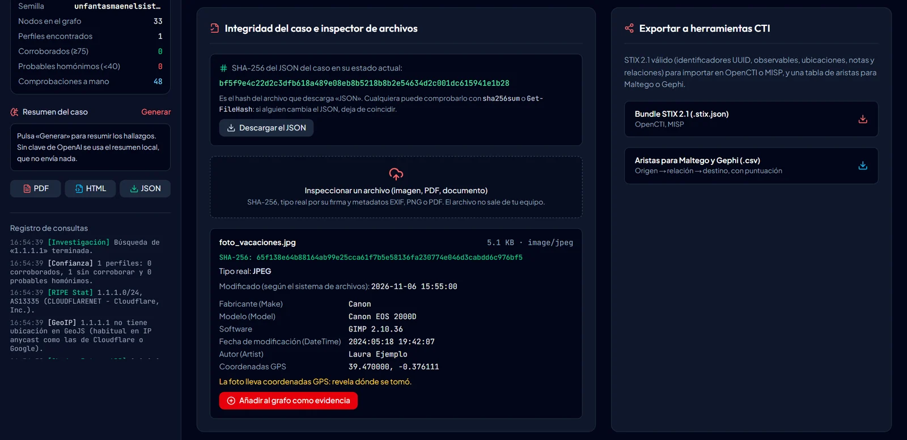
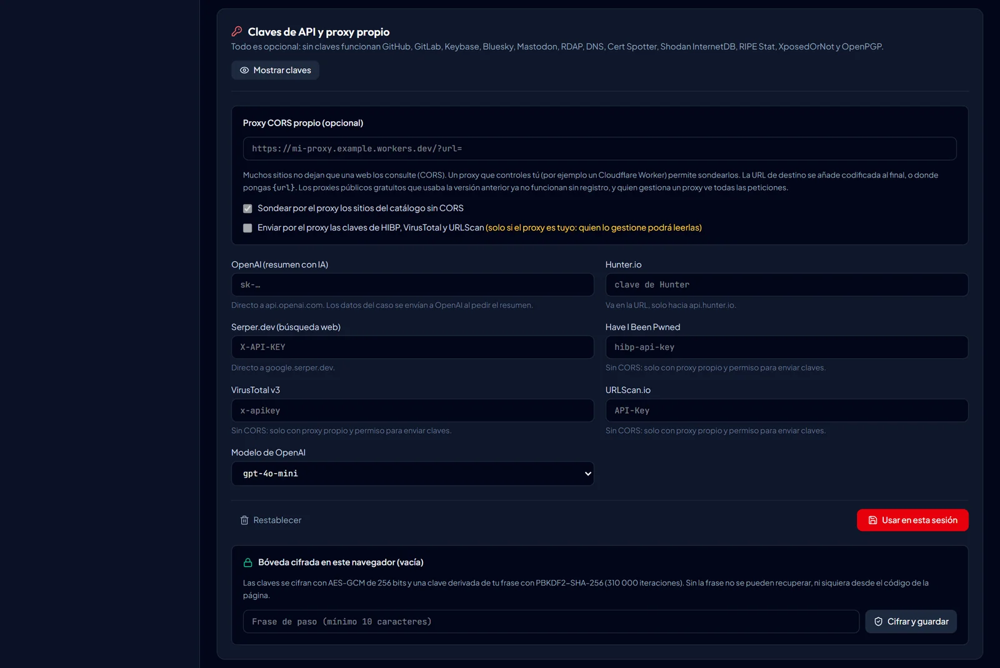
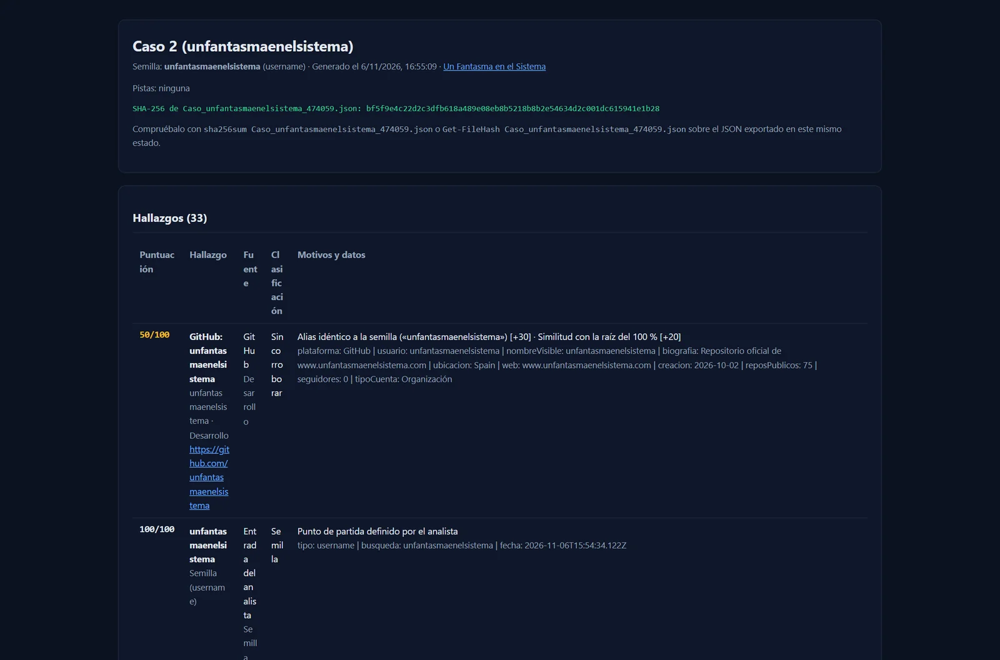
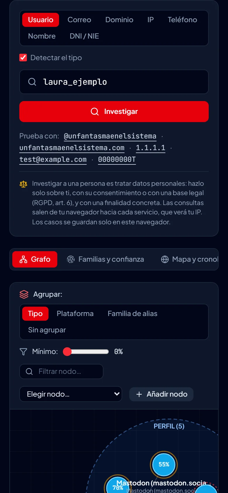

<p align="center">
  <a href="https://www.unfantasmaenelsistema.com"></a>
</p>

<h1 align="center">Fantasma OSINT</h1>

<p align="center">
  <b>Investigación OSINT en el navegador: usuarios, correos, dominios, IP, teléfonos y DNI/NIE con fuentes públicas</b><br>
  Grafo de correlación · Puntuación de identidad con pistas · Verificación manual sitio a sitio · Mapa y línea de tiempo · Informes con SHA-256 comprobable · STIX 2.1
</p>

<p align="center">
  <a href="https://unfantasmaenelsistema.github.io/Fantasma-OSINT/"><b>▶ Abrir Fantasma OSINT</b></a> ·
  <a href="#qué-hace">Qué hace</a> ·
  <a href="#fuentes">Fuentes</a> ·
  <a href="#cómo-se-puntúa-la-identidad">Cómo se puntúa la identidad</a> ·
  <a href="#privacidad-y-uso-responsable">Privacidad</a> ·
  <a href="#desarrollo">Desarrollo</a> ·
  <a href="https://www.unfantasmaenelsistema.com">unfantasmaenelsistema.com</a> ·
  <a href="LICENSE">MIT</a>
</p>

<p align="center">
  
  
  
  
  
</p>

<p align="center">
  
</p>

Se parte de un dato (un alias, un correo, un dominio, una IP, un teléfono, un nombre o un DNI/NIE) y la aplicación consulta fuentes públicas desde tu navegador: perfiles en 58 sitios, registro RDAP del dominio, certificados TLS, DNS, Shodan InternetDB, brechas conocidas… Todo se dibuja en un grafo desde el que se puede seguir tirando del hilo. Para cada perfil calcula si es **la misma persona** o un homónimo, comparando lo que publica con lo que ya sabes de ella.

> [!NOTE]
> No hay servidor propio: las consultas salen de tu navegador hacia cada servicio, y los casos se guardan solo en tu navegador (IndexedDB). Arranca con un **caso de ejemplo con datos ficticios** para practicar sin investigar a nadie.

## Qué hace

- **Siete tipos de entrada**: usuario, correo, dominio, IP, teléfono (E.164), nombre y DNI/NIE. El tipo se detecta solo.
- **Usuarios en 58 sitios**, con un resultado honesto para cada uno: *encontrado*, *no existe*, *sin respuesta* o *a mano*. Los sitios que responden 200 aunque el usuario no exista (Instagram, TikTok, Twitch, PyPI…) nunca se dan por encontrados: van a la cola de verificación manual con su enlace.
- **Grafo** agrupado por tipo, plataforma o familia de alias, con filtro por puntuación, selector de nodos accesible con teclado, zoom y exportación a PNG. Desde cada nodo se puede investigar el dato que contiene: un subdominio, una IP, un alias…
- **Familias de alias**: leet speak, letras repetidas, separadores, prefijos, sufijos y años, cada una con su botón para buscarla.
- **Pistas del analista** (nombre, ciudad, web) con las que se recalcula la puntuación de identidad de todos los perfiles.
- **Mapa y línea de tiempo**: altas de cuentas, registro del dominio, primera captura en la Wayback Machine, brechas…
- **Verificación manual**: cola de enlaces para comprobar a mano. Al marcar «existe», el perfil pasa al grafo como confirmado por el analista.
- **Inspector de archivos**: SHA-256, tipo real por la firma (descubre un `.exe` disfrazado de `.pdf`) y metadatos EXIF de JPEG (cámara, software, autor, fecha y **GPS**), texto de PNG e información de PDF. El archivo no sale de tu equipo.
- **Informes**: PDF, HTML autónomo y JSON, con el **SHA-256 del JSON** para comprobar que nadie lo ha tocado. También STIX 2.1 para OpenCTI o MISP y CSV de aristas para Maltego o Gephi.
- **Resumen** local, que no envía nada, o con tu clave de OpenAI, previo aviso de que los datos del caso se enviarán a OpenAI.

<p align="center">
  
</p>

## Fuentes

| Entrada | Fuente | Clave | Desde el navegador |
| :-- | :-- | :-: | :-- |
| Usuario | APIs de GitHub, GitLab, Dev.to, HackerNews, Keybase, Lichess, Chess.com, Crates.io, Bluesky y Mastodon | No | Sí (admiten CORS) |
| Usuario | 22 sitios que responden 404 o un texto de error si el usuario no existe (YouTube, Vimeo, HackerOne…) | No | Solo con tu proxy; si no, a mano |
| Usuario | 26 sitios que responden 200 siempre o bloquean (Instagram, TikTok, X, Reddit…) | — | Solo a mano |
| Correo | XposedOrNot (brechas), MX, SPF y DMARC por DNS sobre HTTPS, claves en keys.openpgp.org, Gravatar | No | Sí |
| Correo | Hunter.io | Sí | Sí |
| Correo | Have I Been Pwned | Sí | Solo con tu proxy y tu permiso |
| Dominio | RDAP (registrador, alta, caducidad, DNSSEC), Cert Spotter / crt.sh, DNS, Wayback Machine | No | Sí |
| Dominio | VirusTotal, URLScan.io | Sí | Solo con tu proxy y tu permiso |
| IP | Shodan InternetDB (puertos, CVE), GeoJS / ipwho.is (aproximada), RIPE Stat (BGP) | No | Sí |
| Teléfono | Prefijo UIT E.164, tipo de número en España, enlace de WhatsApp | No | Local |
| DNI / NIE | Letra de control (módulo 23) y búsquedas preparadas (BOE, BORME, documentos) | No | Local |
| Nombre | Búsquedas preparadas y, con clave, Serper.dev | Opcional | Sí |

**Proxy propio.** Muchos sitios no dejan que una página web los consulte (CORS). Un proxy que controles tú, como un Cloudflare Worker, permite sondearlos. La URL de destino se añade codificada al final, o donde pongas `{url}`. Las claves de HIBP, VirusTotal y URLScan solo viajan por el proxy si lo permites expresamente, porque quien lo gestione podría leerlas.

<p align="center">
  
</p>

## Cómo se puntúa la identidad

Que exista el mismo alias en dos sitios no prueba que sea la misma persona. Por eso la puntuación solo **suma lo que coincide** y **resta lo que contradice**:

| Factor | Puntos | Cuándo |
| :-- | :-: | :-- |
| Alias | 10–30 | Idéntico a la semilla (30), contiene la raíz (20), otro (10) |
| Familia de alias | 0–20 | Similitud de Levenshtein con la raíz |
| Nombre | +20 / +15 / −10 | Coincide con el esperado, coincide con el de otro perfil encontrado, o no coincide |
| Ubicación | +15 / −15 | Misma ciudad o país que la esperada, o una distinta |
| Web | +15 / +12 | Enlaza al dominio esperado o a la misma web que otro perfil |

- **≥ 75: corroborado.**
- **40–74: sin corroborar.** Un alias idéntico sin más datos se queda en 50: existe, pero no se sabe si es esa persona.
- **< 40: probable homónimo.**

Tener biografía o ubicación no suma por sí solo. Los perfiles detectados solo por el código HTTP tampoco pueden pasar de «sin corroborar». El veredicto del analista («es la persona» u «homónimo») se guarda aparte y **no cambia la puntuación**, que sigue mostrando lo que dicen las pruebas. Los datos técnicos (RDAP, DNS, Shodan…) llevan la fiabilidad de su fuente, que no mide identidad.

<p align="center">
  
</p>

<details>
<summary><b>Más capturas</b></summary>

<p align="center">
  
  <br><br>
  
  <br><br>
  
  <br><br>
  
  <br><br>
  
</p>

</details>

## Privacidad y uso responsable

- **Investigar a una persona es tratar datos personales.** Hazlo sobre ti, con su consentimiento o con una base legal (RGPD, art. 6), y con una finalidad concreta. Para aprender, usa el caso de ejemplo o tus propios perfiles.
- **Cada servicio ve tu IP** y lo que consultas. Con un proxy, también lo ve quien lo gestiona.
- **Los casos se guardan solo en tu navegador** (IndexedDB). Puedes exportarlos y borrarlos.
- **Claves de API**: por defecto están solo en memoria y desaparecen al cerrar la pestaña. Si quieres guardarlas, se cifran con AES-GCM de 256 bits y una clave derivada de tu frase de paso con PBKDF2-SHA-256 (310 000 iteraciones). Sin la frase no se pueden recuperar.
- **Integridad**: el SHA-256 que muestran los informes es el del archivo JSON del caso. Compruébalo con `sha256sum Caso_….json` o con `Get-FileHash Caso_….json`.

## Desarrollo

Requiere Node.js 20 o superior.

```bash
npm install
npm run dev       # servidor de desarrollo
npm test          # pruebas (Vitest)
npm run lint      # comprobación de tipos
npm run build     # compila en dist/
```

- `src/services/osintEngine.ts`: el orquestador de las búsquedas. Con fetch simulado se prueba sin red.
- `src/services/aliasAndConfidenceEngine.ts`: las familias de alias, la puntuación de identidad y el cruce entre perfiles.
- `src/data/sherlockSites.json`: los 58 sitios y cómo se comprueba cada uno.
- `src/engine/`: módulos sin interfaz:
  - `geo.ts`: ubicaciones escritas a coordenadas.
  - `phone.ts`: E.164.
  - `nationalId.ts`: DNI y NIE.
  - `vault.ts`: bóveda AES-GCM.
  - `integrity.ts`: SHA-256, URL seguras y CSV.
  - `stix.ts`: STIX 2.1.
  - `fileMeta.ts`: EXIF, PNG y PDF.

Las pruebas comprueban, entre otras cosas:

- que tener datos públicos no sube la puntuación;
- que el caso de ejemplo separa a la persona del homónimo;
- que ningún sitio que responde 200 siempre se da por encontrado;
- que las claves nunca viajan por el proxy sin permiso;
- que el hash es el del JSON exportado;
- que el bundle STIX tiene identificadores UUID y referencias resueltas;
- que el lector de EXIF extrae el GPS.

Cada `push` a `main` publica la web en GitHub Pages con `.github/workflows/deploy.yml`, después de pasar las pruebas y la comprobación de tipos.

## Novedades de la versión 2

**Resultados fiables**

- Con la configuración anterior solo se sondeaban 9 sitios por proxy, y 4 de ellos (Instagram, TikTok, PyPI y Twitch) devuelven 200 aunque el usuario no exista: cualquier alias «aparecía» en ellos. Ahora se ha comprobado cada sitio con un usuario inexistente y otro real, y los 58 tienen su método de comprobación.
- Los proxies públicos que usaba la v1 ya no funcionan (corsproxy.io exige registro y allorigins está caído), así que todo lo que dependía de ellos fallaba sin avisar. Ahora el proxy es opcional y propio. Para los dominios se usa Cert Spotter, que admite CORS, y la geolocalización de IP pasa a GeoJS.
- Cada sitio queda como «encontrado», «no existe», «sin respuesta» o «a mano»; antes, los errores y los límites de peticiones se callaban.

**Puntuación de identidad**

- La de la v1 premiaba tener datos, no que coincidieran. Una ubicación que contradecía la pista sumaba +11, y la simple URL del avatar se presentaba como «hash de avatar correlacionado». Así, casi cualquier perfil público salía «verificado».
- Ahora suma lo que coincide, resta lo que contradice y cruza nombre y web entre perfiles.
- El veredicto del analista ya no altera la puntuación, y el recálculo no destroza los datos técnicos.

**Seguridad**

- La «bóveda cifrada» de la v1 era un XOR con una cadena escrita en el código. Ahora es AES-GCM con frase de paso, y la bóveda antigua se migra y se borra.
- Las claves de HIBP y URLScan ya no pasan por un proxy de terceros.
- El mapa insertaba como HTML la ubicación escrita en perfiles externos; ahora se muestra como texto. En el grafo y los informes solo se enlazan URL http(s), y el CSV va protegido contra fórmulas.
- La página publicada lleva una política de seguridad de contenidos (CSP).

**Datos corregidos**

- La geolocalización por texto ya no confunde «Buenos Aires» con Madrid (antes contaba las letras «es»).
- Un teléfono sin prefijo ya no se convierte en uno de Australia.
- Un prefijo desconocido ya no se sitúa en Madrid con confianza 90.
- Los subdominios ya no admiten dominios que solo terminan igual (`evilexample.com`).
- Se añaden SPF y DMARC, que el README de la v1 anunciaba y no existían.

**Exportaciones**

- El STIX de la v1 no era válido: identificadores sin UUID, propiedades de objetos de dominio en los observables y tipos de relación con espacios.
- El «sello de cadena de custodia» se calculaba sobre una parte del caso que nadie podía comprobar; ahora es el SHA-256 del JSON exportado.

**Otros cambios**

- Inspector de archivos con lectura real de EXIF, PNG y PDF. Antes buscaba palabras sueltas y declaraba «archivo limpio».
- Caso de ejemplo con datos ficticios en lugar de datos inventados sobre la propia marca. Buscar desde él abre un caso nuevo.
- Los casos ya no se duplican en localStorage, y se migran los de la v1.
- Zoom con la rueda sin mover la página, soporte táctil, selector de nodos con teclado y etiquetas en los formularios.
- Diseño adaptable sin desbordes de 320 a 1440 px.
- Aviso legal junto al buscador y confirmación antes de enviar datos a OpenAI.
- Fuera las dependencias de AI Studio y las capturas generadas; capturas reales.

## Créditos y licencia

Creado por [Un fantasma en el sistema](https://www.unfantasmaenelsistema.com) como recurso para aprender OSINT con responsabilidad. Distribuido con [licencia MIT](LICENSE).
